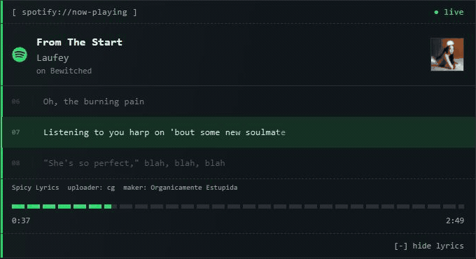

# Spotify Now Playing

Покажите, что слушаете, на своём сайте, в OBS или в Telegram.

[English](README.md) · [Конфигурация](docs/configuration.ru.md) · [Размещение](docs/deployment.ru.md)



## Возможности

- Текущий трек, исполнитель, обложка и прогресс воспроизведения в виджете с терминальным оформлением.
- Текст песен с подсветкой строк и слогов, ручной прокруткой и поддержкой reduced motion.
- Одно Telegram-сообщение, которое обновляется при смене трека, паузе и продолжении воспроизведения.
- Один Docker-контейнер с сохранением подключения Spotify и состояния сообщения.

Каждая установка подключает один Spotify-аккаунт. Текст песен и Telegram включаются по желанию.

## Быстрый старт

Склонируйте репозиторий и перейдите в его каталог:

```sh
git clone https://github.com/HehPospast/spotify-now-playing.git
cd spotify-now-playing
```

Нужны Docker с Compose и собственное [приложение Spotify](https://developer.spotify.com/dashboard). Для подключённого аккаунта действуют [ограничения development mode](https://developer.spotify.com/documentation/web-api/concepts/quota-modes).

### 1. Зарегистрируйте callback Spotify

В настройках своего приложения Spotify включите доступ к Web API и добавьте Redirect URI:

```text
http://127.0.0.1:8080/auth/callback
```

Скопируйте **Client ID**. Client Secret не требуется. На всех этапах настройки используйте `127.0.0.1`, в том числе в браузере.

### 2. Создайте конфигурацию

Из корня репозитория выполните в Bash или PowerShell:

```sh
docker run --rm -v "${PWD}:/work" -w /work python:3.13-slim python scripts/configure.py
```

В Linux добавьте `--user "$(id -u):$(id -g)"` после `--rm`, чтобы созданный файл принадлежал вашему пользователю.

Команда создаст `.env` со случайным паролем владельца и ключом шифрования. Существующий `.env` останется без изменений. Если Python уже установлен, вместо Docker можно выполнить `python scripts/configure.py`.

Откройте `.env` и укажите Client ID своего приложения в `SPOTIFY_CLIENT_ID`. Храните файл в закрытом доступе и сохраняйте ключ шифрования при обновлении.

### 3. Запустите и подключите Spotify

```sh
docker compose up --build -d
```

Откройте [страницу настройки](http://127.0.0.1:8080/setup), введите `ADMIN_KEY` из `.env` и нажмите **Connect with Spotify**. Плеер будет доступен по адресу [127.0.0.1:8080/widget](http://127.0.0.1:8080/widget).

Для публичного размещения настройте HTTPS и callback своего домена по [руководству](docs/deployment.ru.md).

## Подключение текста песен и Telegram

| Интеграция | Добавьте в `.env` | Настройка |
| --- | --- | --- |
| Синхронизированный текст | `SPICY_LYRICS_SECRET_KEY` | [Spicy Lyrics](docs/configuration.ru.md#spicy-lyrics) |
| Сообщение в Telegram | `TELEGRAM_BOT_TOKEN` и `TELEGRAM_CHAT_ID` | [Telegram-бот](docs/configuration.ru.md#telegram) |

После изменения `.env` примените настройки:

```sh
docker compose up -d --force-recreate
```

Бот публикует ссылку «Исполнитель - Трек» и редактирует то же сообщение при смене песни. При паузе или отсутствии воспроизведения появляется «Сейчас ничего не слушаю». ID сообщения сохраняется после перезапуска.

Текст песен предоставляет [Spicy Lyrics](https://developers.spicylyrics.org/). В виджете отображаются ссылки на источник и авторов синхронизации.

## Встраивание виджета

Замените домен в примере на адрес своей установки:

```html
<iframe
  src="https://music.example.com/widget"
  title="Spotify now playing"
  width="100%"
  height="400"
  style="border:0"
  loading="lazy"
></iframe>
```

Фон страницы прозрачный, виджет занимает доступную ширину. Для OBS добавьте URL виджета как браузерный источник. Для начала подойдёт размер 680 x 400.

**Воспроизведение публично.** Любой, у кого есть доступ к виджету, видит текущий трек и включённый текст песни. Spotify-токены остаются на сервере. Отключить аккаунт можно через `/setup`, отозвать разрешение можно в [настройках Spotify](https://www.spotify.com/account/apps/).

## Документация

- [Конфигурация и решение проблем](docs/configuration.ru.md): переменные окружения, доступ Spotify, текст песен и Telegram.
- [Размещение и обслуживание](docs/deployment.ru.md): HTTPS, хранение данных, обновления и резервные копии.
- [Безопасность](SECURITY.md): хранение ключей и сообщения об уязвимостях, на английском.

## Лицензия

[MIT](LICENSE). Для внешних сервисов, обложек и текстов песен действуют собственные условия и права. Подробности приведены в [уведомлениях о сторонних компонентах](THIRD_PARTY_NOTICES.md).
